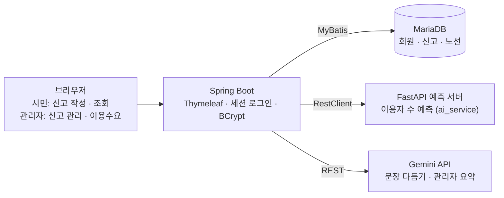

# 울산 버스 불편 신고 접수 · 처리 시스템

**신고는 쉽게, 처리는 급한 것부터.** 시민은 클릭 몇 번으로 노선별 불편을 신고하고, 관리자는 점수와 이유가 붙은 목록에서 급한 신고부터 처리합니다.
그린AI캠퍼스 3차 팀 프로젝트(COMMIT, 3인)이며, 저는 팀장이었습니다.

| 신고 접수 (유형 · 노선 · 예시 문장 · AI 다듬기) | 관리자 (AI 요약 · 긴급 순 정렬) |
|---|---|
|  |  |

## 한눈에 보기

| | |
|---|---|
| 신고 유형 순위 | 상위 4개 유형이 전체의 **72.2%** (경상일보 2025.10.20 · 울산시 2025년 1~9월 자료, 기사 건수로 계산) |
| 반복 신고 | 같은 사람이 같은 유형을 같은 주에 여러 번 신고해도 **1건**으로 집계 |
| 처리 우선순위 | 점수 = 0.4×심각도 + 0.3×이용자 규모 + 0.2×방치 + 0.1×반복 |
| 긴급 규칙 | 사고 위험 유형이거나 **14일 이상 방치**된 신고는 점수와 무관하게 맨 위 |

## 구조



## 제가 맡은 부분

- 로그인/회원가입, 신고 작성 · 조회 · 수정
- **메인 유형 순위**: 반복 신고 중복 제외, 가상 신고 시뮬레이션으로 순위 점검
- **AI 문장 도우미**: 유형별 예시 문장 3개, 짧은 메모를 신고 문장으로 다듬기(쓸지 말지는 시민이 선택)
- 관리자 페이지, 관리자 AI 비서(지난 7일 신고 요약), **처리 우선순위** 적용과 규칙 검증
- 예측 서버의 노선 목록과 울산 BIS 이름으로 `BUS_ROUTE` 동기화

이용자 수 예측 모델(`ai_service`), 노선 지도, 이용수요 화면은 팀원이 맡았습니다.

## 핵심 코드

| 주제 | 위치 |
|---|---|
| 처리 우선순위 점수와 긴급 규칙 | [`ReportPriorityService.java`](src/main/java/com/commit/project3/service/ReportPriorityService.java#L20) |
| 유형 순위 쿼리 (주간 반복 신고 1건 집계) | [`report.xml`](src/main/resources/mapper/report.xml#L18) |
| 신고 문장 다듬기 AI | [`ReportAiService.java`](src/main/java/com/commit/project3/service/ReportAiService.java) |

```sql
-- 같은 사람이 같은 유형을 같은 주(월~일)에 여러 번 신고하면 1건으로 센다
COUNT(DISTINCT CONCAT_WS('|', IFNULL(R.MEMBER_NO, CONCAT('n', R.REPORT_NO)), YEARWEEK(R.REG_DATE, 1))) AS cnt
```

## 기술 스택

Java 17 · Spring Boot · MyBatis · Thymeleaf · MariaDB · BCrypt · Gemini API · FastAPI · Chart.js · Gradle

## 실행

1. MariaDB `project-3` 데이터베이스를 준비합니다. (스키마 SQL은 이 저장소에 없습니다.)
2. 예측 서버를 실행합니다: [`ai_service/README.md`](ai_service/README.md)
3. `application.yaml`(DB 접속 · 예측 서버 주소 · API 키)을 본인 환경에 맞게 채우고 실행합니다.

```bash
./gradlew bootRun
```

## 한계

- 우선순위 비중(40·30·20·10)은 **시작값**입니다. 실제 운영 데이터에서 관리자 판단과 비교해 조정해야 합니다.
- 예측 서버의 학습 데이터는 [`ai_service/README.md`](ai_service/README.md)에 적힌 대로 AI 합성데이터이며, 개별 값의 정밀 예측이 아닌 통계적 경향입니다. 우선순위의 "이용자 규모" 점수에 이 예측값이 쓰입니다.
- 모바일을 위한 반응형 화면은 아직 없습니다.

## 기록

- [프로젝트 작업 일지 (Notion)](https://fluffy-plane-19c.notion.site/3e3a969c48278070bbaaf5dee74b31b4)
