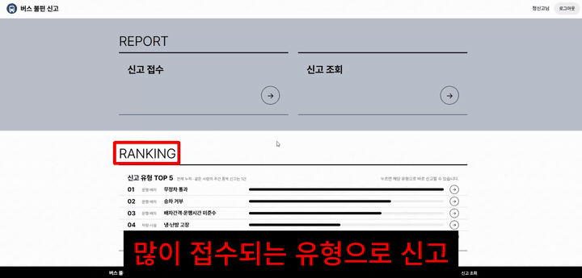
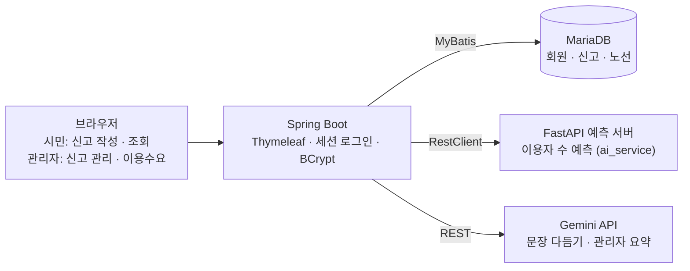

# 울산 버스 불편 신고 접수 · 처리 시스템

**신고는 쉽게, 처리는 급한 것부터.** 시민은 클릭 몇 번으로 노선별 불편을 신고하고, 관리자는 점수와 이유가 붙은 목록에서 급한 신고부터 처리합니다.
그린AI캠퍼스 3차 팀 프로젝트(COMMIT, 3인)입니다.

## 제가 맡은 부분

저는 예측 서버 이식과 연동을 맡았습니다. [내 커밋 보기](https://github.com/isnull0x00/project3/commits/dev?author=isnull0x00)

- 예측 서버(FastAPI)를 `ai_service`로 이식했습니다(모델 학습 코드는 제외).
- 노선·날짜별 일별 이용자 수 예측 API와 시간대별 예상 승차 인원 API를 만들었습니다. 시간대 비율표는 84일 자료로 만들고, 마지막 1주를 빼 둔 시험에서 평일 합산 오차 16.2%를 확인했습니다.
- 예측 가능 기간이 28일 이하로 남으면 `/health`가 경고하게 했습니다.
- 관리자 지도에 일별 예측과 시간대별 막대 영역을 추가했고, 예측 서버가 꺼져도 화면은 멈추지 않고 안내만 보이게 했습니다.

### 예측 서버 API

| 요청 | 설명 |
|---|---|
| `GET /predict?routeNo=&from=&to=` | 노선의 날짜별 이용자 수. 최대 31일, 학습 마지막 날 + 56일까지 |
| `GET /predict/hourly?routeNo=&date=` | 하루의 시간대별(0~23시) 예상 승차 인원. 일별 예측값 × (노선, 날 유형, 시각) 비율 |
| `GET /health` | 상태와 불러온 모델. 예측 가능 기간이 28일 이하로 남으면 `warnings`에 남은 일수 표시 |

- **모델 파일 검증:** 모델은 pickle이라 불러오는 것이 곧 코드 실행입니다. 저장소에 올린 파일의 sha256과 다르면 서버가 시작할 때 불러오지 않게 했습니다.
- **시간대 비율표는 JSON:** 코드가 실행되지 않는 형식으로 두었고, 응답의 `limited`가 true면 근거가 약하다는 표시입니다.

<details>
<summary>시간대 예측 설계 보기</summary>

1. 일별 예측값에 (노선, 날 유형, 시각)별 비율을 곱해 시간대 인원을 만듭니다.
2. 노선의 표본이 작으면 전체 평균 비율을 섞습니다(`shareBasis`: route / blend / global).
3. 그 날 유형의 자료가 없으면 가까운 유형으로 대신하고 `shareDayKind`에 표시합니다.
4. 비율표는 07-13 ~ 10-04의 84일 자료로 만들었고, 마지막 1주를 빼 둔 시험에서 평일 합산 오차 16.2%를 확인했습니다.
5. 비율표가 없거나 깨져도 `/predict`는 동작하고 `/predict/hourly`만 503을 돌려줍니다.

**한계:** 학습 데이터가 합성데이터라 개별 값의 정밀 예측이 아닙니다. 예측 가능 기간이 끝나면 모든 노선이 422로 거절되므로 모델을 주기적으로 다시 저장해야 합니다.

</details>

| 신고 접수 (유형 · 노선 · 예시 문장 · AI 다듬기) | 관리자 (AI 요약 · 긴급 순 정렬) |
|---|---|
|  |  |

## 한눈에 보기 (팀 결과)

| | |
|---|---|
| 신고 유형 순위 | 상위 4개 유형이 전체의 **72.2%** (경상일보 2025.10.20 · 울산시 2025년 1~9월 자료, 기사 건수로 계산) |
| 반복 신고 | 같은 사람이 같은 유형을 같은 주에 여러 번 신고해도 **1건**으로 집계 |
| 처리 우선순위 | 점수 = 0.4×심각도 + 0.3×이용자 규모 + 0.2×방치 + 0.1×반복 |
| 긴급 규칙 | 사고 위험 유형이거나 **14일 이상 방치**된 신고는 점수와 무관하게 맨 위 |

## 구조



## 핵심 코드

| 주제 | 위치 |
|---|---|
| 노선·날 유형별 시간대 비율 계산 | [`hourly.py`](ai_service/app/hourly.py#L53) |
| 모델 파일 sha256 검증 | [`artifact.py`](ai_service/app/artifact.py#L177) |
| 예측 가능 기간 경고 기준 | [`predict_api.py`](ai_service/app/predict_api.py#L39) |
| 시간대별 예측 호출·연동 | [`HourlyRidershipForecastService.java`](src/main/java/com/commit/project3/service/HourlyRidershipForecastService.java) |

```python
if verify:
    meta = read_summary(directory, scope)
    if meta.get("sha256") != _sha256(model_path):
        raise ArtifactError("모델 파일이 요약(해시)과 다릅니다. ...")
bundle = joblib.load(model_path)
```

pickle은 불러오는 것이 곧 코드 실행이라, 해시가 맞는 파일만 불러옵니다.

## 기술 스택

Java 17 · Spring Boot · MyBatis · Thymeleaf · MariaDB · BCrypt · Gemini API · FastAPI · Chart.js · Gradle

## 실행

1. MariaDB `project-3` 데이터베이스를 준비합니다. (스키마 SQL은 이 저장소에 없습니다.)
2. 예측 서버를 실행합니다: [`ai_service/README.md`](ai_service/README.md)
3. `application.yaml`(DB 접속 · 예측 서버 주소 · API 키)을 본인 환경에 맞게 채우고 실행합니다.

```bash
./gradlew bootRun
```

## 한계

- 우선순위 비중(40·30·20·10)은 **시작값**입니다. 실제 운영 데이터에서 관리자 판단과 비교해 조정해야 합니다.
- 예측 서버의 학습 데이터는 [`ai_service/README.md`](ai_service/README.md)에 적힌 대로 AI 합성데이터이며, 개별 값의 정밀 예측이 아닌 통계적 경향입니다. 우선순위의 "이용자 규모" 점수에 이 예측값이 쓰입니다.
- 모바일을 위한 반응형 화면은 아직 없습니다.

## 기록

- [프로젝트 작업 일지 (Notion)](https://fluffy-plane-19c.notion.site/3e3a969c48278070bbaaf5dee74b31b4)
