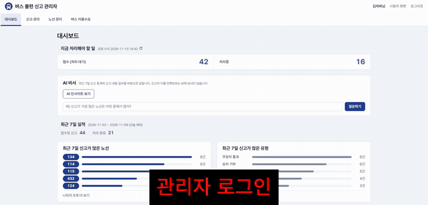
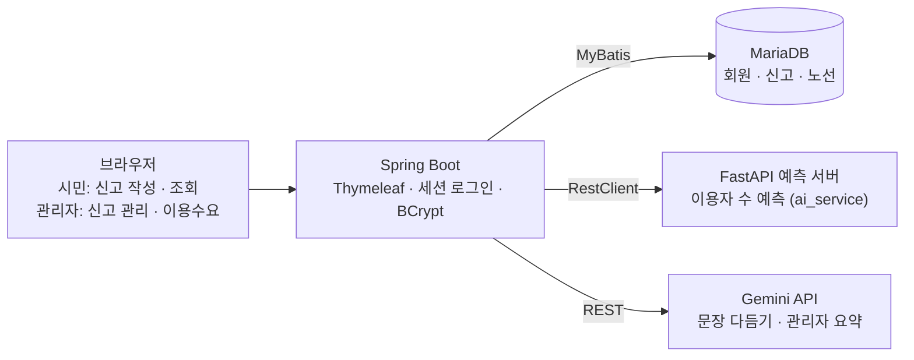

# 울산 버스 불편 신고 접수 · 처리 시스템

**신고는 쉽게, 처리는 급한 것부터.** 시민은 클릭 몇 번으로 노선별 불편을 신고하고, 관리자는 점수와 이유가 붙은 목록에서 급한 신고부터 처리합니다.
그린AI캠퍼스 3차 팀 프로젝트(COMMIT, 3인)입니다.

      

## 예측 서버와 시간대별 예측

이 저장소에서 저는 **노선별 이용자 수 예측 서버(FastAPI)와 관리자 지도 연동**을 구현했습니다.
[내 커밋 보기](https://github.com/isnull0x00/project3/commits/dev?author=isnull0x00)

| 구현 | 결과 (조건) |
|---|---|
| 일별 이용자 수 예측 `/predict` | 오차 10.9% (후보 9개 비교, 마지막 56일 최종 확인) |
| 시간대별 예상 승차 인원 `/predict/hourly` | 비율 오차 13.9%, 일별 오차까지 합친 평일 16.2% (7~10월 자료) |
| 예측 서버 장애 대비 | 서버가 꺼져도 화면은 멈추지 않고 안내를 표시 |
| 모델 파일 검증 | 저장소에 올린 파일의 sha256과 다르면 불러오지 않음 |

- 예측 방법은 기계학습 6개와 단순 규칙 3개를 같은 조건에서 비교해 골랐습니다. 결과는 [`docs/forecast-analysis.md`](docs/forecast-analysis.md)에 있습니다.
- 예측 가능 기간이 28일 이하로 남으면 `/health`가 경고합니다.

### 예측 서버 API

| 요청 | 설명 |
|---|---|
| `GET /predict?routeNo=&from=&to=` | 노선의 날짜별 이용자 수. 최대 31일, 학습 마지막 날 + 56일까지 |
| `GET /predict/hourly?routeNo=&date=` | 하루의 시간대별(0~23시) 예상 승차 인원. 일별 예측값 × (노선, 날 유형, 시각) 비율 |
| `GET /health` | 상태와 불러온 모델. 예측 가능 기간이 28일 이하로 남으면 `warnings`에 남은 일수 표시 |

- **모델 파일 검증:** 모델은 pickle이라 불러오는 것이 곧 코드 실행입니다. 저장소에 올린 파일의 sha256과 다르면 서버가 시작할 때 불러오지 않게 했습니다.
- **시간대 비율표는 JSON:** 코드가 실행되지 않는 형식으로 두었고, 응답의 `limited`가 true면 근거가 약하다는 표시입니다.

<details>
<summary>시간대 예측 설계 보기</summary>

1. 일별 예측값에 (노선, 날 유형, 시각)별 비율을 곱해 시간대 인원을 만듭니다.
2. 노선의 표본이 작으면 전체 평균 비율을 섞습니다(`shareBasis`: route / blend / global).
3. 그 날 유형의 자료가 없으면 가까운 유형으로 대신하고 `shareDayKind`에 표시합니다.
4. 비율표는 07-13 ~ 10-04의 84일 자료로 만들었고, 마지막 1주를 빼 둔 시험에서 평일 합산 오차 16.2%를 확인했습니다.
5. 비율표가 없거나 깨져도 `/predict`는 동작하고 `/predict/hourly`만 503을 돌려줍니다.

**한계:** 학습 데이터가 합성데이터라 개별 값의 정밀 예측이 아닙니다. 예측 가능 기간이 끝나면 모든 노선이 422로 거절되므로 모델을 주기적으로 다시 저장해야 합니다.

</details>

## 화면

| 신고 접수 (유형 · 노선 · 예시 문장 · AI 다듬기) | 관리자 (AI 요약 · 긴급 순 정렬) |
|---|---|
|  |  |

## 주요 기능

| | |
|---|---|
| 신고 접수 | 유형·노선을 고르고 예시 문장을 눌러 쓰며, AI가 문장을 다듬어 줍니다 |
| 반복 신고 | 같은 사람이 같은 유형을 같은 주에 여러 번 신고해도 **1건**으로 집계 |
| 처리 우선순위 | 점수 = 0.4×심각도 + 0.3×이용자 규모 + 0.2×방치 + 0.1×반복 |
| 긴급 규칙 | 사고 위험 유형이거나 **14일 이상 방치**된 신고는 점수와 무관하게 맨 위 |
| 관리자 화면 | AI 요약과 급한 순 정렬, 지도에 노선별 예측 이용자 수 표시 |
| 신고 유형 순위 | 상위 4개 유형이 전체의 **72.2%** (경상일보 2025.10.20 · 울산시 2025년 1~9월 자료, 기사 건수로 계산) |

## 구조



## 핵심 코드

| 하는 일 | 위치 |
|---|---|
| 예측 서버 호출, 시간 제한(연결 0.5초 · 읽기 3초), 실패 시 안내로 전환 | [`RidershipForecastService.java`](src/main/java/com/commit/project3/service/RidershipForecastService.java#L50) |
| 노선·날 유형별 시간대 비율 계산 | [`hourly.py`](ai_service/app/hourly.py#L53) |
| 모델 파일 sha256 검증 | [`artifact.py`](ai_service/app/artifact.py#L177) |
| 시간대별 예측 연동 | [`HourlyRidershipForecastService.java`](src/main/java/com/commit/project3/service/HourlyRidershipForecastService.java) |
| 예측 가능 기간 경고 기준 | [`predict_api.py`](ai_service/app/predict_api.py#L39) |

```java
// 예측 서버가 멈춰도 화면이 오래 기다리지 않게 시간 제한을 둠
SimpleClientHttpRequestFactory factory = new SimpleClientHttpRequestFactory();
factory.setConnectTimeout(Duration.ofMillis(500));
factory.setReadTimeout(Duration.ofSeconds(3));
```

예측 서버가 느려지거나 꺼져도 신고 화면은 대기하지 않고, 관리자 화면에는 안내만 표시합니다.

## 실행

1. MariaDB `project-3` 데이터베이스를 준비합니다. (스키마 SQL은 이 저장소에 없습니다.)
2. 예측 서버를 실행합니다: [`ai_service/README.md`](ai_service/README.md)
3. `application.yaml`(DB 접속 · 예측 서버 주소 · API 키)을 본인 환경에 맞게 채우고 실행합니다.

```bash
./gradlew bootRun
```

## 측정 조건과 범위

- **예측 정확도**: 오차는 학습 기준일 이후 마지막 56일을 따로 떼어 한 번만 본 최종 확인 값입니다. 시간대 비율은 7~10월 자료로 만들었습니다.
- **예측 자료**: 이용자 수 자료는 국토교통부가 통계적 경향 분석용으로 제공한 AI 합성데이터라, 개별 값이 아니라 경향을 보는 용도입니다. 이 예측값이 우선순위의 "이용자 규모" 점수에 쓰입니다.
- **예측 가능 기간**: 학습 마지막 날 + 56일까지입니다. 이후에는 모델을 다시 저장해야 하고, 남은 기간이 28일 이하가 되면 `/health`가 알려 줍니다.
- **우선순위 비중**: 0.4 · 0.3 · 0.2 · 0.1은 시작값입니다. 운영 데이터가 쌓이면 관리자 판단과 비교해 조정합니다.
- **화면**: PC 화면 기준이고, 모바일용 반응형은 아직 없습니다.

## 기록

- [개발 일지 (Notion)](https://elderly-chill-2ac.notion.site/9b7e1a8cb19f83de90b9817b1c102e5e)
